<div align="center">

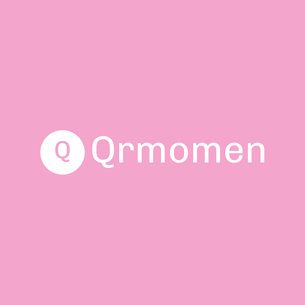

# QRMomen

**Event photos, one album.**  
Bring everyone’s photos together into one shared event album, transferred directly between nearby devices over Bluetooth and local Wi-Fi without internet or accounts.

[](https://qrmomen.indramahkota.info)
[](https://play.google.com/store/apps/details?id=com.qrmomen.app)
[](https://github.com/indramahkota/qrmomen-releases/releases/latest)

<br/>

<a href="https://play.google.com/store/apps/details?id=com.qrmomen.app">
  
</a>

<br/><br/>

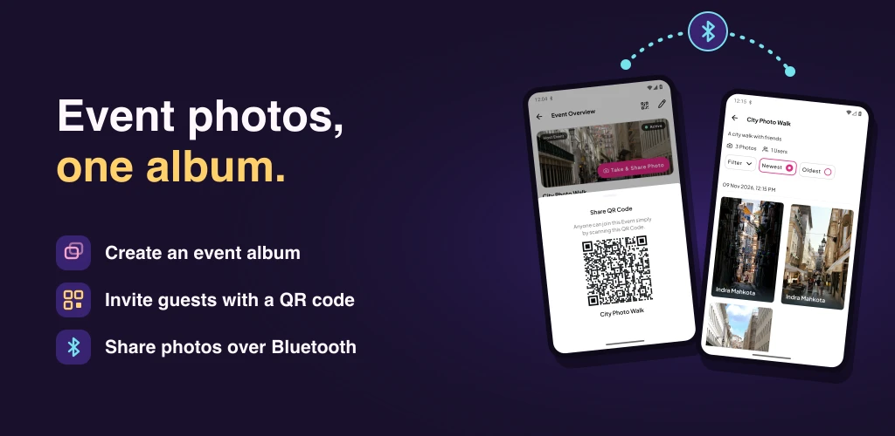

</div>

---

## Official Links

- 🌐 **Landing Page (Website):** [https://qrmomen.indramahkota.info](https://qrmomen.indramahkota.info)  
  *(Tersedia juga dalam [Bahasa Indonesia](https://qrmomen.indramahkota.info/id))*
- 📱 **Google Play Store:** [QRMomen on Google Play](https://play.google.com/store/apps/details?id=com.qrmomen.app)
- 💼 **Case Study:** [indramahkota.info/projects/qrmomen](https://indramahkota.info/projects/qrmomen)
- 📦 **All Releases & Installers:** [GitHub Releases](https://github.com/indramahkota/qrmomen-releases/releases)

---

## Key Use Cases & Screenshots

QRMomen solves the friction of collecting event photos by eliminating cloud uploads, mandatory accounts, and internet dependencies.

### 1. Host: Create an Event & Share Invitation QR Code
The host sets up an event album with a cover photo, title, and schedule. The app immediately generates an offline invitation QR code that guests can scan on the spot.

| Events List | Create Event Album | Invitation QR Code |
| :---: | :---: | :---: |
| 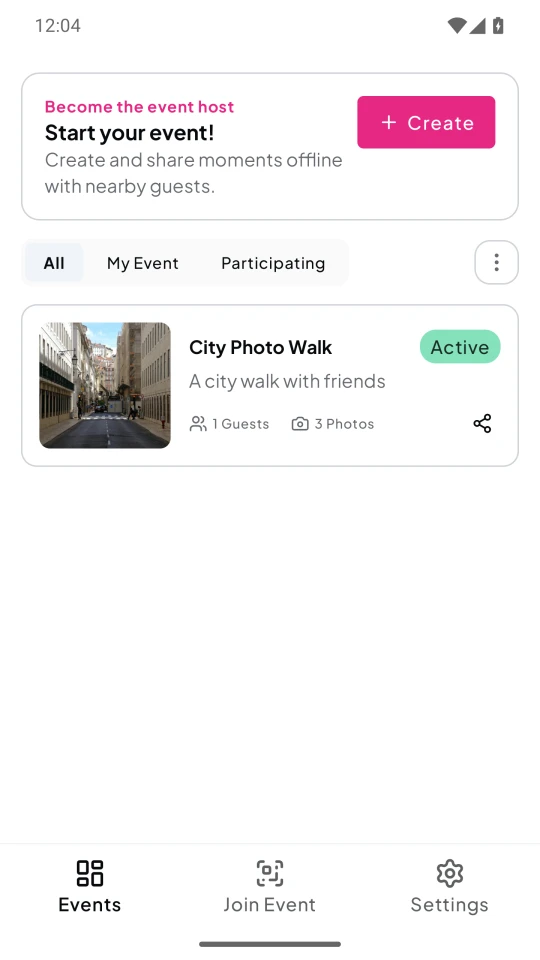 | 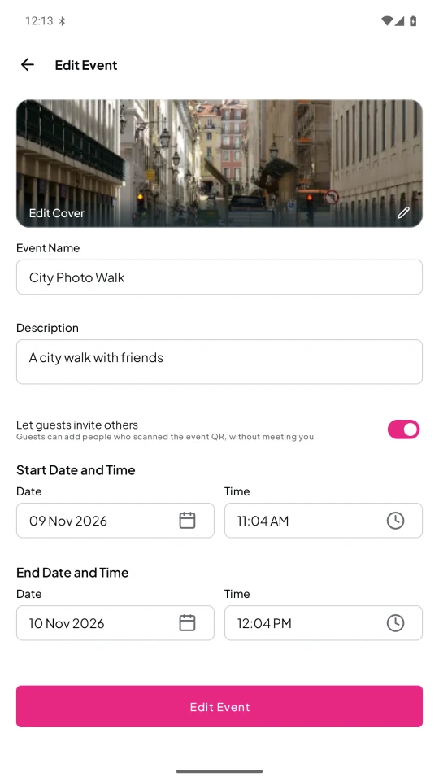 | 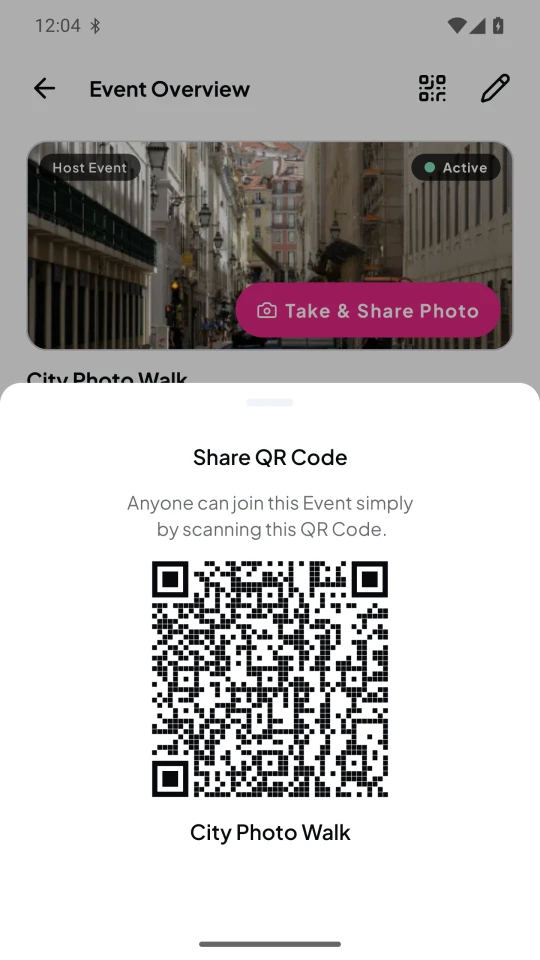 |

### 2. Guests: Join Instantly Without an Account
Guests open QRMomen and scan the host's QR code to join the event album instantly. No registration, email, or internet access is required.

### 3. Peer-to-Peer Nearby Sharing (Offline Sync)
When participants are together, opening the album automatically discovers nearby peers. Full-resolution photos are transferred securely over Bluetooth L2CAP and accelerated when connected to a shared local Wi-Fi network or mobile hotspot.

| Nearby Sharing Ready | Media Sync in Progress |
| :---: | :---: |
| 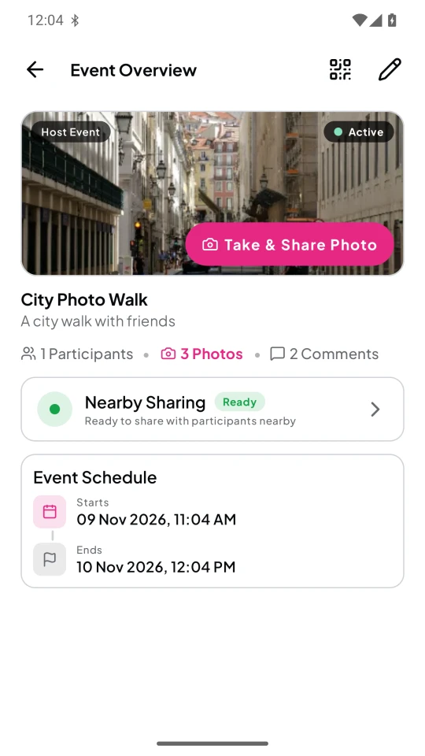 | 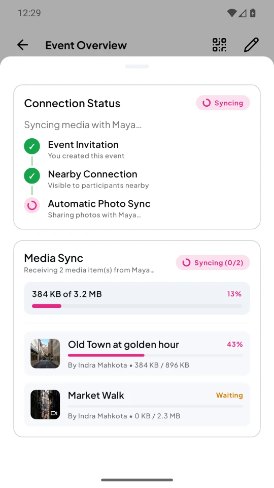 |

### 4. Collaborative Event Gallery & High-Res Details
Everyone's photos come together in a unified event gallery. Guests and hosts can inspect full-resolution photos, view details, and participate in comments.

| Shared Album Gallery | Photo Detail & Comments |
| :---: | :---: |
| 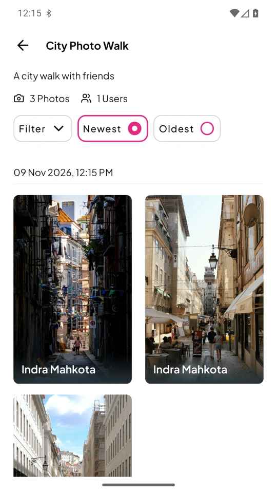 | 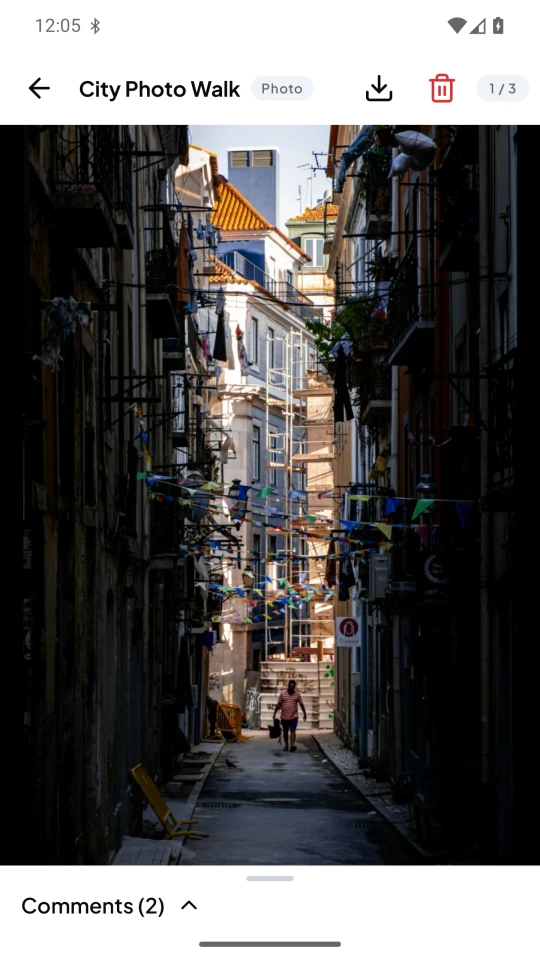 |

### 5. Cross-Platform Desktop Experience
QRMomen is built with Kotlin Multiplatform and Compose Multiplatform, running natively on Android, iOS, macOS, Windows, and Linux. View, browse, and manage event albums on a larger display.

| Desktop: Events List | Desktop: Album Gallery |
| :---: | :---: |
| 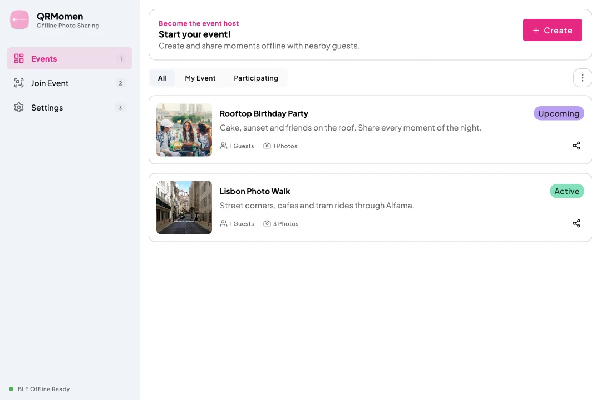 | 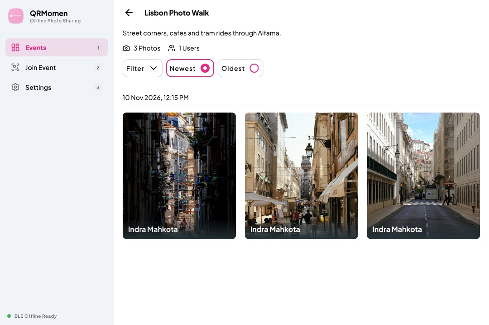 |

---

## Installers & Downloads

Each [release](https://github.com/indramahkota/qrmomen-releases/releases) contains every installer and `SHA256SUMS`.

The workflow in [`.github/workflows/release.yml`](.github/workflows/release.yml) builds the installers from the private QRMomen source repository and publishes each release here. This repository holds no application source.

| Platform | File | Minimum |
| --- | --- | --- |
| Android (APK) | [QRMomen-android.apk](https://github.com/indramahkota/qrmomen-releases/releases/latest/download/QRMomen-android.apk) | Android 10 |
| Android (Google Play) | [QRMomen on Google Play](https://play.google.com/store/apps/details?id=com.qrmomen.app) | Android 10 |
| iOS | `QRMomen-ios-unsigned.ipa` in the [latest release](https://github.com/indramahkota/qrmomen-releases/releases/latest) | iOS 18.5 |
| macOS (Apple silicon) | [QRMomen-macos-arm64.dmg](https://github.com/indramahkota/qrmomen-releases/releases/latest/download/QRMomen-macos-arm64.dmg) | macOS 12+ |
| macOS (Intel) | [QRMomen-macos-x64.dmg](https://github.com/indramahkota/qrmomen-releases/releases/latest/download/QRMomen-macos-x64.dmg) | macOS 12+ |
| Windows | [QRMomen-windows-x64.msi](https://github.com/indramahkota/qrmomen-releases/releases/latest/download/QRMomen-windows-x64.msi), [QRMomen-windows-x64.exe](https://github.com/indramahkota/qrmomen-releases/releases/latest/download/QRMomen-windows-x64.exe) | Windows 10+ x64 |
| Linux (Debian, Ubuntu) | [amd64](https://github.com/indramahkota/qrmomen-releases/releases/latest/download/qrmomen-linux-amd64.deb), [arm64](https://github.com/indramahkota/qrmomen-releases/releases/latest/download/qrmomen-linux-arm64.deb) | |
| Linux (Fedora, openSUSE) | [x86_64](https://github.com/indramahkota/qrmomen-releases/releases/latest/download/qrmomen-linux-x86_64.rpm), [aarch64](https://github.com/indramahkota/qrmomen-releases/releases/latest/download/qrmomen-linux-aarch64.rpm) | |

> **Note:** `QRMomen-android.aab` is the bundle uploaded to Google Play. The APK in this repository is signed with a different key than the Google Play build, so it cannot update a Google Play installation, and the reverse.

## Installation Notes

- **macOS:** The macOS DMG is not notarized. Open the app the first time with `Control-click` -> `Open`.
- **iOS:** The IPA is unsigned. Sign it with your own Apple ID (for example with Sideloadly or AltStore) before installing.
- **Desktop Sync:** Windows and Linux builds support local storage and viewing of albums. Bluetooth peer-to-peer sync is currently available on Android and iOS.

## Verification & Checksums

To verify the integrity of downloaded files against `SHA256SUMS`:

```bash
shasum -a 256 -c SHA256SUMS --ignore-missing
```

On Windows (PowerShell):

```powershell
Get-FileHash <file> -Algorithm SHA256
```

Compare the resulting hash with the corresponding entry in `SHA256SUMS`.
