<div align="center">

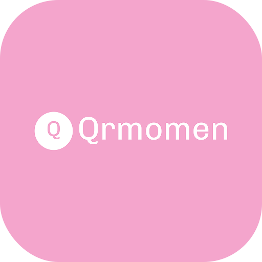

# QRMomen

**Event photos, one album.**  
Bring everyone’s photos together into one shared event album, transferred directly between nearby devices over Bluetooth and local Wi-Fi without internet or accounts.

[](https://qrmomen.indramahkota.info)
[](https://play.google.com/store/apps/details?id=com.qrmomen.app)
[](https://github.com/indramahkota/qrmomen-releases/releases/latest)

<br/>

<a href="https://play.google.com/store/apps/details?id=com.qrmomen.app">
  
</a>

<br/><br/>

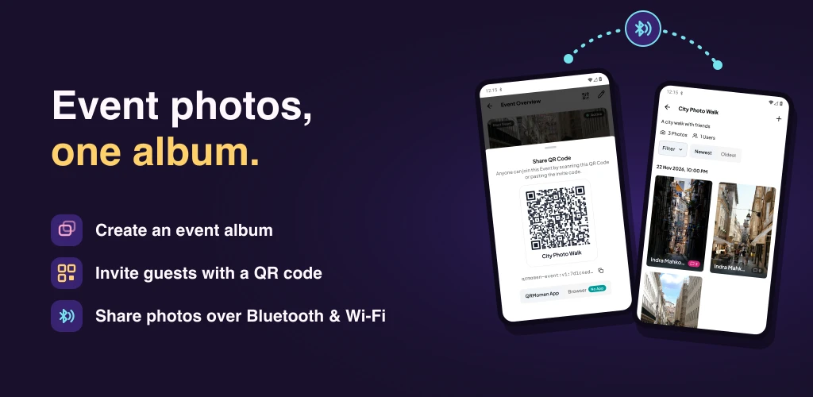

</div>

---

## Official Links

- 🌐 **Landing Page (Website):** [https://qrmomen.indramahkota.info](https://qrmomen.indramahkota.info)  
  *(Tersedia juga dalam [Bahasa Indonesia](https://qrmomen.indramahkota.info/id))*
- 📱 **Google Play Store:** [QRMomen on Google Play](https://play.google.com/store/apps/details?id=com.qrmomen.app)
- 💼 **Case Study:** [indramahkota.info/projects/qrmomen](https://indramahkota.info/projects/qrmomen)
- 📦 **All Releases & Installers:** [GitHub Releases](https://github.com/indramahkota/qrmomen-releases/releases)

---

## Key Use Cases & Screenshots

QRMomen solves the friction of collecting event photos by eliminating cloud uploads, mandatory accounts, and internet dependencies.

### 1. Host: Create an Event & Share Invitation QR Code
The host sets up an event album with a cover photo, title, and schedule. The app immediately generates an offline invitation QR code that guests can scan on the spot.

| Events List | Create Event Album | Invitation QR Code |
| :---: | :---: | :---: |
| 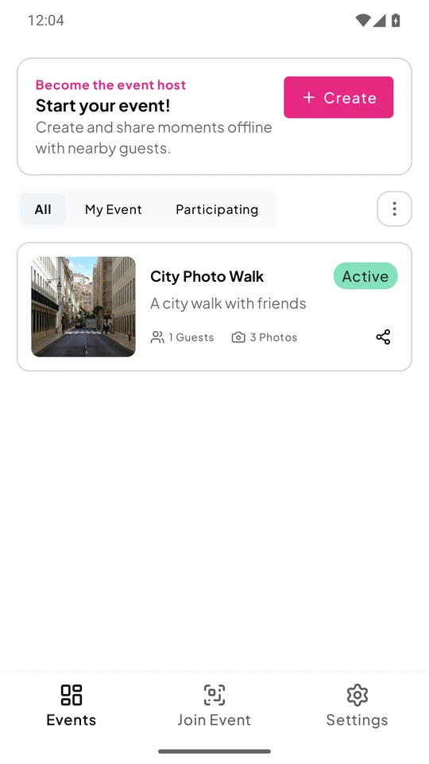 | 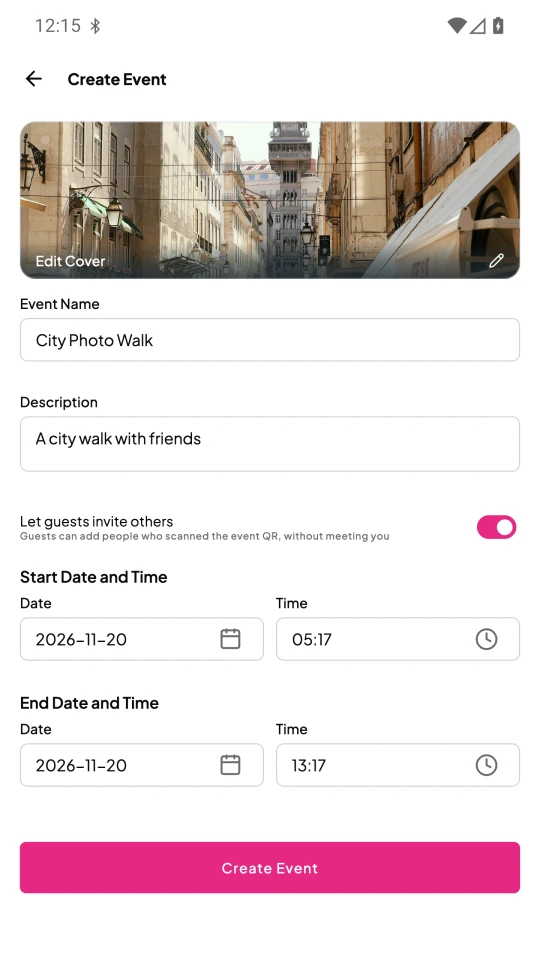 | 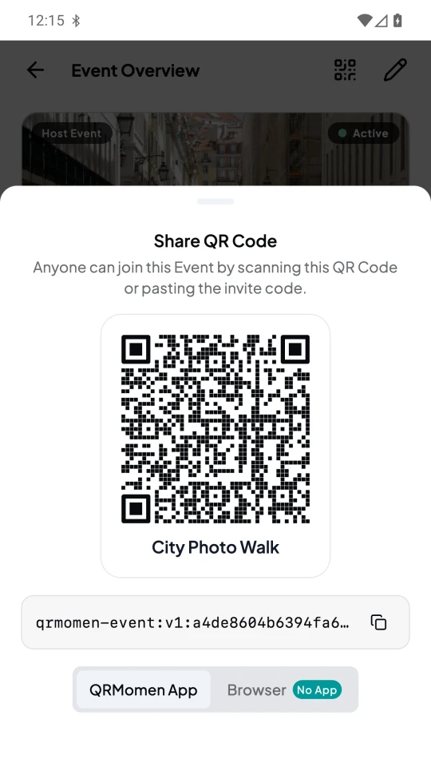 |

### 2. Guests: Join Instantly Without an Account
Guests open QRMomen and scan the host's QR code to join the event album instantly. No registration, email, or internet access is required.

### 3. Peer-to-Peer Nearby Sharing (Offline Sync)
When participants are together, opening the album automatically discovers nearby peers. Full-resolution photos are transferred securely over Bluetooth L2CAP and accelerated when connected to a shared local Wi-Fi network or mobile hotspot.

| Nearby Sharing Ready | Media Sync in Progress |
| :---: | :---: |
| 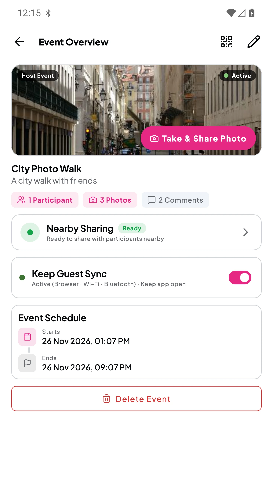 | 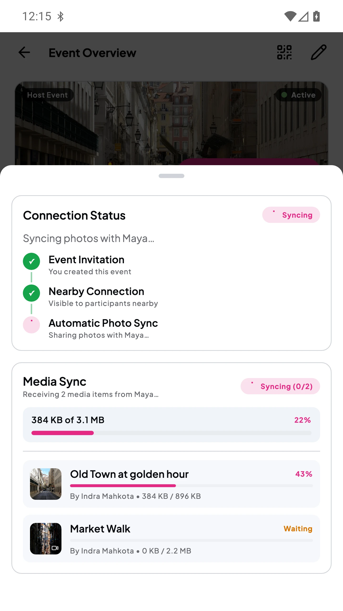 |

### 4. Collaborative Event Gallery & High-Res Details
Everyone's photos come together in a unified event gallery. Guests and hosts can inspect full-resolution photos, view details, and participate in comments.

| Shared Album Gallery | Photo Detail & Comments |
| :---: | :---: |
| 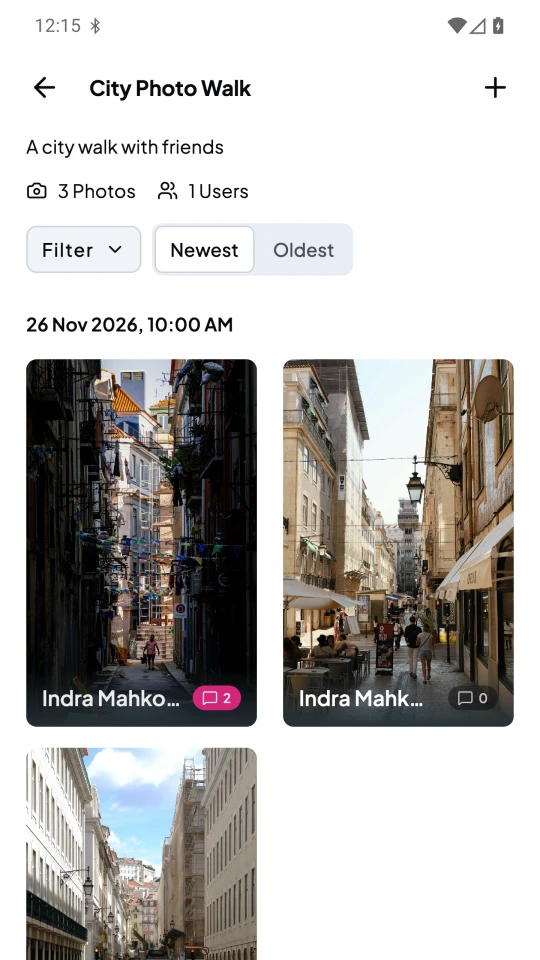 | 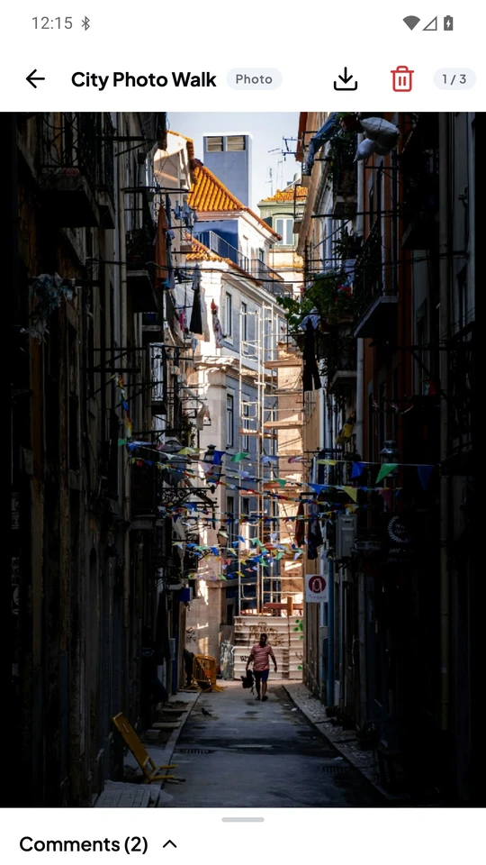 |

### 5. Cross-Platform Desktop Experience
QRMomen is built with Kotlin Multiplatform and Compose Multiplatform, running natively on Android, iOS, macOS, Windows, and Linux, with native desktop apps that run without a JVM. On a computer, take photos and videos with the webcam, scan invitation QR codes, add photos from the computer to an album, and browse and manage event albums on a larger display.

| Desktop: Events List | Desktop: Album Gallery | Desktop: Settings & Wi-Fi Transport |
| :---: | :---: | :---: |
| 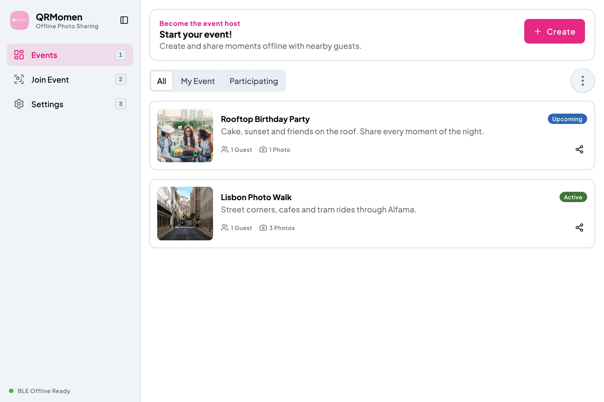 | 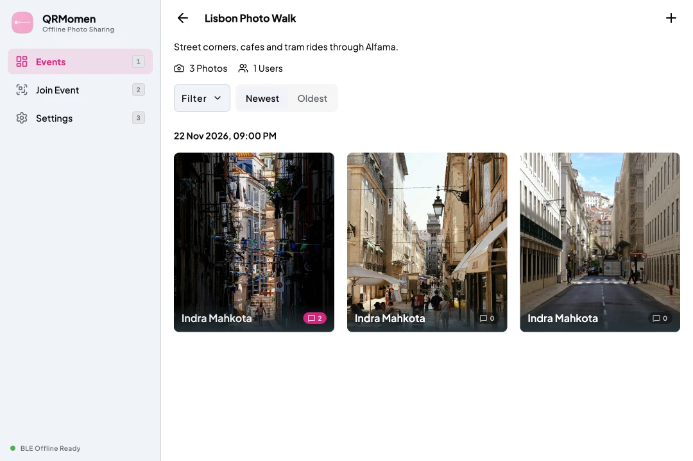 | 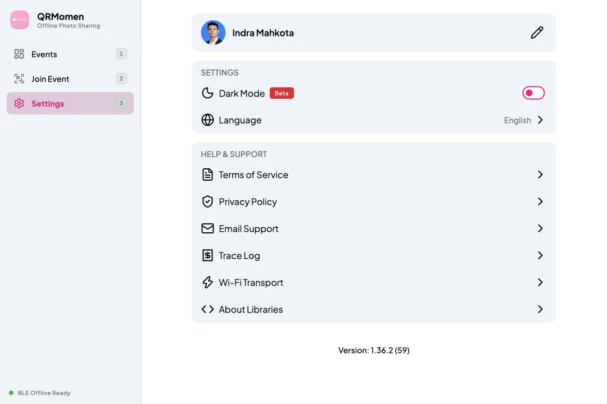 |

---

## Installers & Downloads

| Platform | File | Minimum |
| --- | --- | --- |
| Android (APK) | [QRMomen-android.apk](https://github.com/indramahkota/qrmomen-releases/releases/latest/download/QRMomen-android.apk) | Android 10 |
| Android (Google Play) | [QRMomen on Google Play](https://play.google.com/store/apps/details?id=com.qrmomen.app) | Android 10 |
| macOS (Apple silicon) | [QRMomen-macos-arm64.dmg](https://github.com/indramahkota/qrmomen-releases/releases/latest/download/QRMomen-macos-arm64.dmg) | macOS 12+ |
| Windows | [QRMomen-windows-x64.msi](https://github.com/indramahkota/qrmomen-releases/releases/latest/download/QRMomen-windows-x64.msi), [QRMomen-windows-x64.zip](https://github.com/indramahkota/qrmomen-releases/releases/latest/download/QRMomen-windows-x64.zip) (portable) | Windows 10+ x64 |
| Linux (Debian, Ubuntu) | [qrmomen-linux-amd64.deb](https://github.com/indramahkota/qrmomen-releases/releases/latest/download/qrmomen-linux-amd64.deb) | Ubuntu 25.04+, Debian 13+ (SDL3) |
| Linux (Fedora) | [qrmomen-linux-x86_64.rpm](https://github.com/indramahkota/qrmomen-releases/releases/latest/download/qrmomen-linux-x86_64.rpm) | Fedora 42+ (SDL3) |

> **Note:** The APK and the Google Play build use different signing keys and cannot update each other.

## Installation Notes

- **macOS:** first launch with `Control-click` → `Open`.
- **Windows:** the MSI installs per user. The zip is portable: extract and open `QRMomen.exe`.
- **Camera:** photos, videos and QR scanning on every platform. Linux records, plays and compresses video with GStreamer 1.x and an H.264 encoder (`x264enc`, `openh264enc` or `avenc_h264`), which the packages recommend.
- **Nearby sync:** over Bluetooth and local Wi-Fi or hotspot on Android, iOS, macOS, Linux, and Windows, plus browser-based **Guest Web Share** (no app install needed on the same Wi-Fi).

## Official Sources

- Google Play: `com.qrmomen.app`
- GitHub Releases of this repository

Report installers from other sources to `contact@indramahkota.info`.

## Verification

Build provenance ([GitHub CLI](https://cli.github.com)):

```bash
gh attestation verify QRMomen-windows-x64.msi -R indramahkota/qrmomen-releases
```

`SHA256SUMS` signature ([keys/qrmomen-release-signing.asc](keys/qrmomen-release-signing.asc)):

```text
81D7 08D0 0646 F5F4 5E25  97BF BB16 9B8B DC7C 8F32
```

```bash
curl -sL https://raw.githubusercontent.com/indramahkota/qrmomen-releases/main/keys/qrmomen-release-signing.asc | gpg --import
gpg --verify SHA256SUMS.asc SHA256SUMS
shasum -a 256 -c SHA256SUMS --ignore-missing
```

Windows Authenticode, self-signed `CN=Indra Mahkota, O=QRMomen, C=ID` ([keys/qrmomen-windows-codesign.crt](keys/qrmomen-windows-codesign.crt)), SHA-256:

```text
D0DD3A61D36054A4414C7B77EE12F2B039B68EBD977620771DEC2368F071A61C
```

SHA-1 thumbprint: `8CA21695E039398AF1DA2F5BAB4E322309B5D331` (`Get-AuthenticodeSignature`).

Android APK, `CN=Snappycle, O=Snappycle.io`, SHA-256:

```text
4a91d3c31502e2776966e9652df42f48c738e44204484f007b57b40a79bb3225
```

Check: `apksigner verify --print-certs QRMomen-android.apk`.
